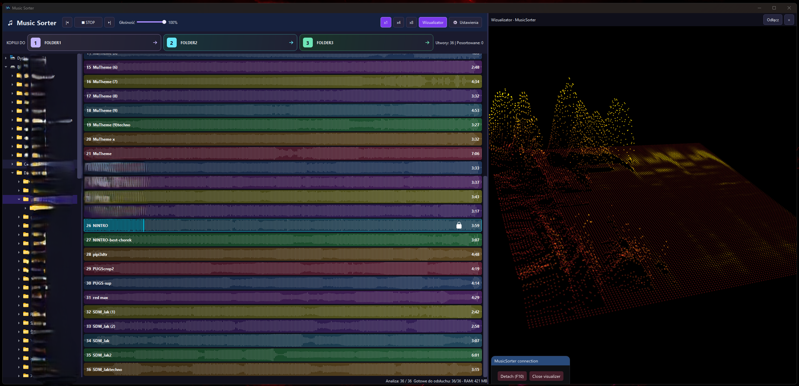

# MusicSorter

A native Windows tool for **very fast listening, comparing tracks and finding the right musical fragment**, by **uberArius**. Move across a waveform to audition that moment, jump between tracks, and copy your selections into three destination folders.

**MusicSorter is built primarily for rapid audio browsing, rather than conventional music playback.** Responsiveness is its priority: complete compressed tracks and seek indexes are kept in RAM, so memory usage can be substantial. It is designed around working batches of roughly 100 tracks.

Developed with the assistance of ChatGPT / Codex.

[Download for Windows](https://github.com/uberArius/musicsorter/releases/latest) · [Source code](https://github.com/uberArius/musicsorter) · [Report a bug](https://github.com/uberArius/musicsorter/issues)

*The screenshot shows an earlier Polish interface. The current release uses English.*

[Watch the video demo on YouTube](https://www.youtube.com/watch?v=EI1nQ3eahcU)

## Features

- Audition any part of a track by moving the pointer across its waveform.
- Quickly move between tracks without repeatedly opening files from disk.
- Lock playback to keep listening while moving the pointer elsewhere; playback advances to the next available track.
- Copy selections into three configurable destination folders using buttons or keyboard shortcuts.
- Originals stay untouched: sorting never deletes, moves or overwrites music files.
- View waveforms in one, four or eight columns.
- Play/stop, previous/next track and volume controls.
- MP3, WAV, FLAC, OGG, M4A, AAC and OPUS support.
- Background waveform generation and track preparation.
- Optional integration with Windows File Explorer and default audio-file associations.
- Local operation: no account or runtime internet connection required.

## Download and run

1. Open the [latest release](https://github.com/uberArius/musicsorter/releases/latest).
2. Download and extract **MusicSorter-1.4.5-Windows-x64.zip**.
3. Run **MusicSorter.exe**.

Requires **Windows 10 or 11, x64**. Keep the DLLs, plugins and license files next to the executable; no Qt or Visual Studio installation is required to run the release. The optional visualizer requires a Direct3D 11-capable GPU.

## Fast browsing and RAM

Choose a folder in the left-hand tree, then move over the waveforms to listen. The pointer's horizontal position selects the playback time. Waveforms help you spot changes in the music and immediately audition those sections.

MusicSorter stores **whole compressed tracks**, packet indexes and waveforms in RAM. It decodes audio as needed and keeps a short PCM playback buffer; it does not retain full decoded PCM for every track. File preparation happens in the background, so the first listen can take longer while a track is loading.

Large files or folders can use a lot of RAM. Under memory pressure, the cache evicts whole tracks; returning to an evicted track may require loading it again. Working with batches of about 100 tracks is the intended workflow, rather than loading an entire music library at once. Actual latency depends on the hardware, audio device and whether the track is already ready in memory.

## Controls

| Control | Action |
| --- | --- |
| Move over a waveform | Preview the track at the pointer's position |
| Click the playing track | Lock / unlock playback and hover preview |
| Click another track while locked | Transfer locked playback to that track |
| 1 / 2 / 3 over a track | Copy it to the corresponding destination |
| Right-click a track | Copy it to destination 3 |
| Destination buttons | Copy the locked track, or the last hovered track |
| PLAY / STOP | Start locked playback / stop |
| Previous / next | Switch tracks, skipping sorted, copying or unavailable tracks |
| x1 / x4 / x8 | Change the number of waveform columns |
| Settings | Set destination folders and labels |

At the end of a locked track, the next available track plays and the lock follows it.

## Also usable as a player with File Explorer

If you prefer, MusicSorter also works as an audio player integrated with Windows File Explorer.

Choose **Settings → Set as default player…**, then confirm the file types in Windows. Double-clicking a supported audio file opens MusicSorter, starts that track and loads the other supported files from its folder, just as selecting that folder in the application would. Further file-open requests go to the running instance.

Keep the application in a permanent location. If you move it, use the registration button again. Windows remains responsible for confirming your default-app selection.

## Optional visualizer

The optional **Spectral Grid** visualizer is a separate project. Its visualization features, controls and technical details are described in the [Spectral Grid repository](https://github.com/uberArius/spectral-grid).

## Build from source

Install Visual Studio 2022 Build Tools with **Desktop development with C++**, a Windows SDK, CMake 3.24+, Ninja, and **Qt 6.10.2 MSVC x64** with Widgets, Multimedia, Concurrent, Network and Test. The tested audio libraries are **FFmpeg 7.1.2**, supplied with that Qt kit; matching headers are included in this repository.

~~~powershell
git clone https://github.com/uberArius/musicsorter.git
cd musicsorter
./build.ps1 -QtRoot "C:/Qt/6.10.2/msvc2022_64"
./package.ps1 -QtRoot "C:/Qt/6.10.2/msvc2022_64" -SkipBuild
~~~

Put CMake and Ninja on PATH. The build includes the visualizer integration snapshot; its initial configuration downloads pinned dependencies if they are not already available. No changes to the separate Spectral Grid repository are required.

Synthetic audio test fixtures are included. To regenerate them, install FFmpeg on PATH and run ./scripts/generate-fixtures.ps1. Some tests require access to an actual Windows audio device and GPU.

See [architecture](docs/ARCHITECTURE.md), [validation](TEST_REPORT.md) and [contributing](CONTRIBUTING.md).

## Settings and cache

- MusicSorter settings: %APPDATA%/MusicSorter/config.json.
- Disposable waveform cache: the application's cache directory under %LOCALAPPDATA%.
- Custom file names, folder names and destination labels are preserved.

## License and attribution

Copyright 2026 uberArius. Licensed under [Apache License 2.0](LICENSE), following the same licensing approach as Spectral Grid. Keep the required license and attribution notices when redistributing.

Original project: **https://github.com/uberArius/musicsorter**

Qt, FFmpeg and other dependencies retain their own licenses. See [third-party notices](THIRD_PARTY_NOTICES.md), the bundled license texts and [dependency source links](licenses/SOURCES.txt).
